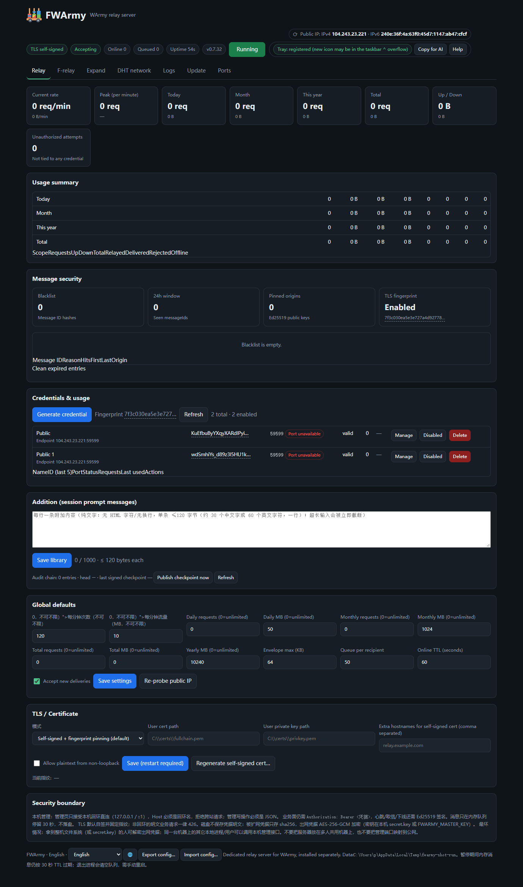
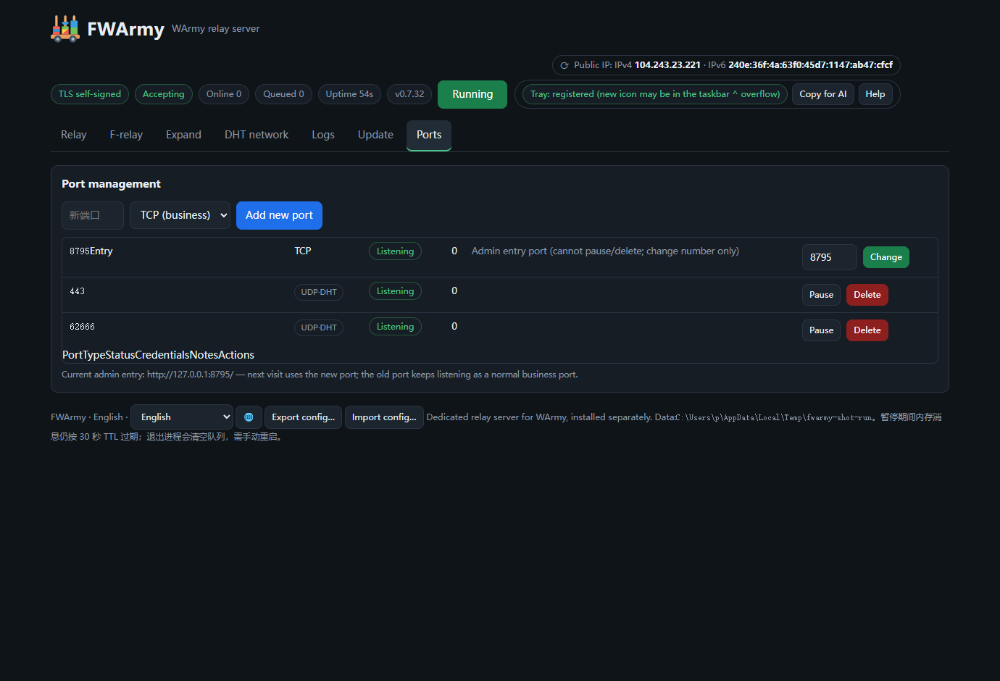

# FWArmy

**A self-hosted message relay for WArmy — single file, zero dependencies, private by default.**

FWArmy is the optional server component of [WArmy](https://github.com/Pondsi/WArmy). It carries messages between WArmy clients when direct connectivity is not possible: clients register their presence, and the server holds short-lived queues and forwards messages to whoever is online.

It is a **relay and rendezvous point — not a storage service**. Message content lives in memory for at most 30 seconds and is never written to disk. The only things persisted are credential hashes, counters, configuration, and message-identity hashes.

[](https://github.com/Pondsi/FWArmy/releases)
[](./LICENSE)
[](https://github.com/Pondsi/FWArmy/releases)
[](./说明.md)

---

## Why it exists

WArmy is a local-first workspace — but friends and colleagues are not always on the same LAN. FWArmy is the **opt-in** networking piece:

- **You host it, you own it.** Run it on an always-on machine at home or on a small cloud box. No third-party relay is involved in your conversations.
- **Privacy is the default.** No analytics, no telemetry, no accounts, no cloud dependency. Only the data you host exists.
- **Nothing to install.** The release binary embeds its own runtime — no Node.js, no admin rights, no paid certificates, on Windows, macOS, and Linux.
- **Secure by construction.** End-to-end encrypted message payloads, TLS with certificate-fingerprint pinning, per-credential rate limits and quotas, replay protection, message-level blacklisting, and origin-signature verification on forwarded messages.
- **Honest about limits.** It relays what it is told, holds it briefly, and says clearly when something is offline or refused.

## Quick start

1. Download the latest release for your platform from the [releases page](https://github.com/Pondsi/FWArmy/releases) (or use the one-line installers below).
2. Run the server — it opens its admin page automatically.
3. In WArmy's server settings, fill in the relay's **address + credential**. The server creates credentials for you on its admin page.

| Platform | One-line install |
| --- | --- |
| Windows x64 | `irm https://github.com/Pondsi/FWArmy/releases/latest/download/install.ps1 \| iex` |
| macOS / Linux | `curl -fsSL https://github.com/Pondsi/FWArmy/releases/latest/download/install.sh \| sh` |

A portable archive is also available for every release if you prefer to run it without an installer.



```
  WArmy A ── register / heartbeat / poll ──►  FWArmy  ◄── relay (queue + forward) ── WArmy B
```

## Requirements

- **OS:** Windows 10/11 x64 · macOS (Intel or Apple Silicon) · Linux x64.
- **Runtime:** none. The release binary embeds its own runtime; there are no native modules and nothing is downloaded at install time.
- **Network:** a reachable address is enough — public IP, a cloud box, or a home machine you can reach. A DNS name is convenient but not required.

## What it does

- **Presence.** Clients register, send heartbeats, and leave explicitly; the server knows who is online and answers lookup queries.
- **Queued delivery.** A message to an online recipient is queued (up to a per-recipient limit) and picked up by the recipient's next poll. Queues are in-memory with a 30-second TTL.
- **Forwarding.** If a message cannot be delivered locally, the server may forward it to another trusted relay — always through configured credentials and pinned TLS fingerprints, never blindly.
- **Fair use.** Every credential has its own speed limits and quota budgets (per minute / day / month / year, in requests and bytes).
- **Built-in shared credentials.** Two public credentials ship with every install so clients can reach the server out of the box; you can disable them and create your own.
- **Automatic updates.** Check, download, verify (SHA-256), and restart from the admin page — or set a policy for unattended updates.

## The admin page

The built-in web console (27 UI languages) covers:

- **Credentials** — create, rename, limit, pause, or delete; usage counters per credential.
- **Ports** — manage the listening ports (relay, expansion, admin entry) and see their live status.
- **Expansion** — connect several relays into a network; messages find their way between servers.
- **Status** — public IP (IPv4/IPv6), online users, queued messages, throughput, uptime.
- **Updates** — check and install new versions with a progress bar.
- **Export / import** — back up or move the whole configuration as a single file.

Ports page (English UI):



## Security model

- **End-to-end encrypted content.** WArmy clients encrypt message payloads before they ever reach the relay (X25519 + HKDF + AES-256-GCM envelopes). The server only handles an **opaque ciphertext** (`envelope`). It has no keys and **cannot read message content**. Even if the relay (or the path to it) is hijacked or compromised, the protected message body does not become readable — an attacker would only see metadata such as who talked to whom and when.
- **Transport.** TLS with a self-signed certificate by default; clients pin the certificate fingerprint, so a swapped certificate is refused before any credential is sent.
- **Authentication.** Bearer credentials; only their SHA-256 hashes are stored. Credential plaintext is shown once at creation and never written to disk in clear text.
- **Abuse control.** Rate limits, quotas, connection caps, request timeouts, and per-origin throttling for unauthenticated traffic.
- **Replay protection.** A message identity may pass at most twice within 24 hours; a third occurrence is dropped and blacklisted by message identity. Blacklists survive restarts.
- **Anti-forgery.** Forwarded messages carry an Ed25519 origin signature over a canonical string that includes the envelope hash; tampering breaks the chain at the next hop.
- **Short-lived memory only.** Queues live in process memory with a 30-second TTL and are never written to disk; logs omit message bodies and credential plaintext.
- **Admin plane isolation.** The admin API accepts loopback only (IP + Host + Origin checks) and is not meant to be published to the internet.
- **Discovery ≠ authorization.** DHT only helps locate peers; actual forwarding always requires configured mutual trust (expand credentials + pinned TLS fingerprints).
- **Plaintext guard.** Non-loopback plaintext HTTP is refused with a TLS-required response unless explicitly allowed.
- **Secrets at rest.** Outbound expand credentials and identity private keys are encrypted on disk (AES-256-GCM) under the local secret key.

## Under the hood

- A single self-contained executable embeds the runtime, the admin page, and the help files.
- No native modules, no install-time downloads, no telemetry endpoints.
- The data directory holds only configuration, credential hashes, counters, and message-identity hashes.
- The relay runs one process, is event-driven, and is designed to stay responsive under heavy load (O(1) hot paths, bounded queues and logs, connection caps).

## FAQ

- **Do I need a public IP?** A reachable address is enough. Behind NAT, port forwarding or a cloud box both work.
- **Is traffic encrypted?** Yes — two layers: client-side end-to-end encryption of message content, plus TLS with certificate-fingerprint pinning on the wire. Non-loopback plaintext is refused unless explicitly allowed.
- **Can FWArmy see my messages?** No. WArmy encrypts payloads before sending; the relay only handles opaque ciphertext and has no keys. Even if the server is hijacked, message content is not exposed.
- **Does it store my messages?** No. Content lives in memory for at most 30 seconds; nothing about message content is written to disk.
- **How is this different from a hosted relay?** No third party is involved. You host the single file, you own the data directory, and nothing leaves your machine except what you send.
- **What if a recipient is offline?** The sender gets an honest "offline" answer; nothing is silently queued on disk or retried later.

## Contributing

Bug reports and feature requests are welcome via [Issues](https://github.com/Pondsi/FWArmy/issues). Keep reports focused: platform, version, and what you observed. There is no CLA and no contributor license required — the [LICENSE](./LICENSE) applies to all contributions.

## Status and honesty

Core workflows are verified on Windows, macOS, and Linux release builds. This project does not claim to be "unhackable": the goal is narrower and testable — **private by default, explicit before sending, honest when a boundary is hit.**

## Documentation and license

- [说明.md](./说明.md): 完整中文使用手册（安装、配置、管理、扩网、常见问题）。
- [LICENSE](./LICENSE): MIT with mandatory attribution to **Pondsi** and a link to the original repository — required for the original code, modified versions, and code snippets, for both personal use and distribution.
- [SPONSORS.md](./SPONSORS.md): support the project.
- [Issues](https://github.com/Pondsi/FWArmy/issues): bug reports and feature requests.
