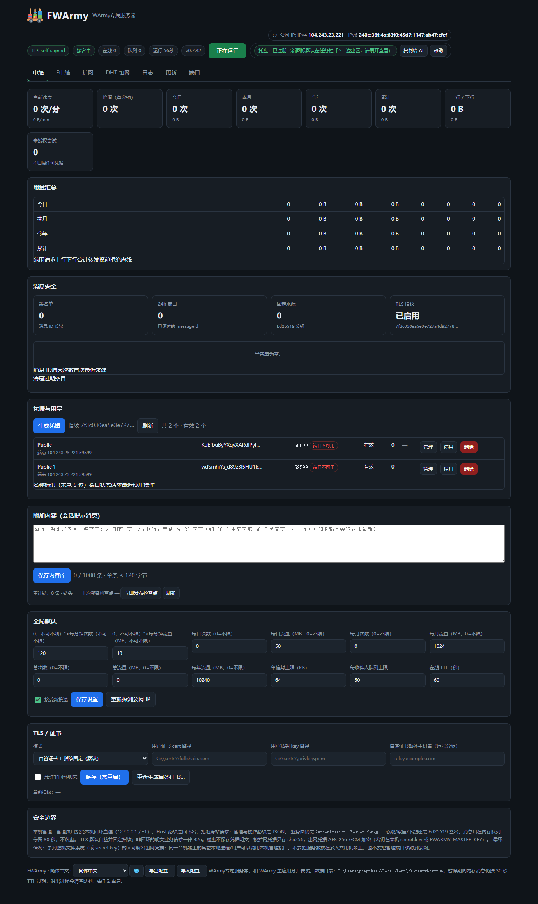
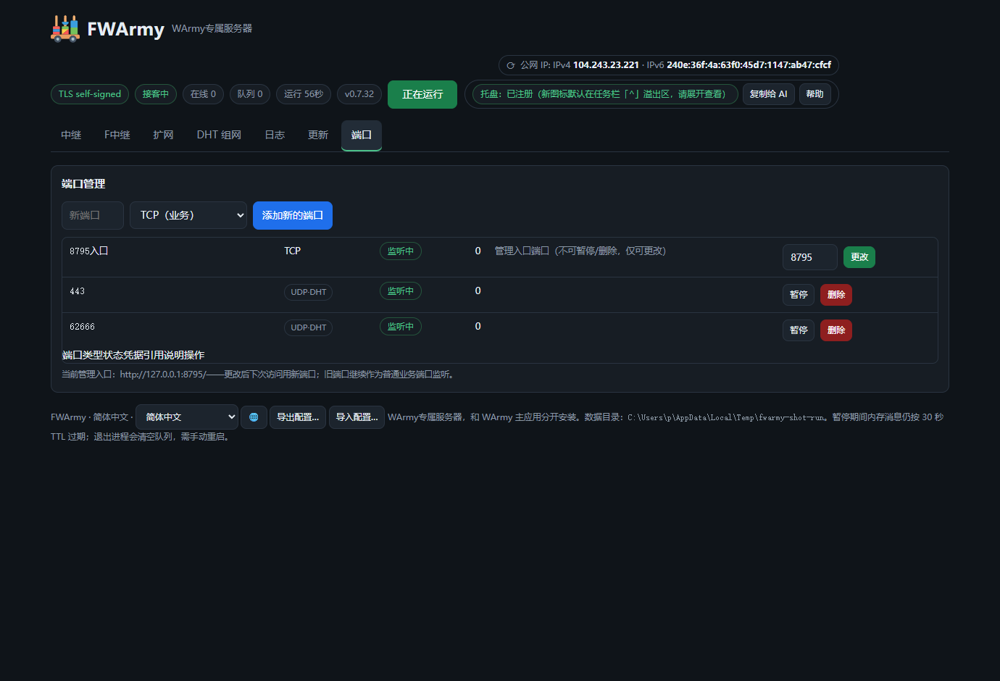

# FWArmy 使用说明

> 本文是 **FWArmy**（WArmy 的可选中继服务器）的中文使用手册。英文简介见 [README](./README.md)。

## 一、这是什么

FWArmy 是 [WArmy](https://github.com/Pondsi/WArmy) 的**可选服务器组件**：当两台设备无法直接互通时，由它代为中转消息——客户端登记在线状态，服务器短暂保存消息队列并转交给出在线的一方。

它是一台**中转与会合服务器，不是存储服务**：

- 消息内容只在内存中停留，**最多 30 秒**，**从不写入磁盘**；
- 磁盘上只保存：凭据哈希、计数统计、配置、消息身份哈希；
- 没有遥测、没有账号体系、没有第三方参与。

## 二、核心特点

- **你自己托管、自己拥有**：放在家里常开的电脑或一台小云主机上即可，对话不经过任何第三方中继。
- **默认私密**：无分析、无埋点、无广告 SDK。
- **免安装运行时**：发布包自带运行时，**不需要安装 Node.js、不需要管理员权限、不需要付费证书**；支持 Windows / macOS / Linux。
- **消息本身已加密**：WArmy 发送的消息在客户端就已端到端加密，FWArmy 只能看到不透明密文，**无法看到真实内容**；即使中继被劫持或被控制，消息正文也不会被读出。
- **安全成体系**：TLS + 证书指纹固定、按凭据限速与配额、重放防护、消息级黑名单、转发消息的来源签名校验、管理面仅限本机回环。
- **对用量诚实**：转发不了就明确说「离线/拒绝」，绝不假装成功。

## 三、快速开始

1. 到 [Releases 页面](https://github.com/Pondsi/FWArmy/releases) 下载对应平台的发布包（或用下方一行命令安装）。
2. 启动服务器——它会自动打开管理页（首次使用选择界面语言）。
3. 在 WArmy 的服务器设置里，填入FWArmy 的**地址 + 凭据**（凭据在管理页里创建，创建后只显示一次明文，请立即保存）。

| 平台 | 一行安装 |
| --- | --- |
| Windows x64 | `irm https://github.com/Pondsi/FWArmy/releases/latest/download/install.ps1 \| iex` |
| macOS / Linux | `curl -fsSL https://github.com/Pondsi/FWArmy/releases/latest/download/install.sh \| sh` |

每个版本也提供便携压缩包：下载解压后运行对应平台的启动脚本即可，无需安装。

管理页界面示例（中文）：

端口页示例（中文）：

## 四、管理页

管理页默认在本机浏览器打开（`https://127.0.0.1:8787/`），共 27 种界面语言。主要功能：

**凭据**
- 创建 / 改名 / 设置限额 / 停用 / 删除；
- 每凭据用量统计（次数与流量，按天/月/年）；
- 内置两个公用凭据（开箱即用，可停用或删除；**删除后不再自动出现**，仅全新安装默认有）。

**端口**
- 查看每个监听端口的状态（监听/异常/暂停）；
- 启用、暂停、删除端口；端口被占用时可强制启用（结束占用进程前请确认）；
- **默认端口（8787 管理入口 / 59599 中继 / 58588 扩网 + UDP 443/62666 DHT 引导）随安装默认就有**；若配置文件缺失默认端口（旧版更新 bug 遗留），启动时会自动补回，无需手动添加。

**F中继（服务器互联）**
- 默认内置 1 条公用接入凭据（端口 58588），开箱即可被其它 FWArmy 接入；**删除后不再自动出现**（仅全新安装默认有）；
- 生成的被扩网凭据只存哈希，明文只显示一次。

**扩网（服务器互联）**
- 把多台 FWArmy 互相配置成对等节点；
- 默认内置 2 条已验证的公用对端（dht2.numumu.com / dht.numumu.com，端口 58588，TLS 指纹已固定，无需再次对比指纹）；**删除后不再自动出现**（仅全新安装默认有）；
- 本机无法投递的消息会按序尝试转交给对等节点（最多 3 个、8 秒预算；用户自定义对端优先，内置公用对端殿后）；
- 转发只走已配置互信的对等节点（凭据 + TLS 指纹固定），发现 ≠ 授权。

**状态**
- 顶部常驻显示本机公网 IP（IPv4 / IPv6 分别显示，点击可重新探测）；
- 在线用户数、队列消息数、吞吐、运行时长。

**更新**
- 检查 / 下载 / 校验（SHA-256）/ 重启，带进度条；
- 更新策略可选：关闭 / 检查并提示 / 自动下载并重启；
- 下载或校验失败不会动当前程序。

**自动重启（定时器）**
- 顶部标签栏右侧的自动重启定时器：勾选启用后，按设定**间隔时间（小时，最长 100000）**周期重启；
- 间隔输入框旁自动备注「大约几天」；可另行指定**下次重启时间（24 小时制，精准到分）**；
- 每次重启完成后，服务器按间隔时间自动算出**下一次重启时间**并显示（附「距离现在还有几天」备注）；
- 重启会清空内存队列（消息 TTL 30 秒属正常），配置与数据目录不受影响。

**导出 / 导入**
- 把整套配置（含凭据、扩网关系、附加内容）导出为单个文件；
- 换机或备份时导入即可恢复。

## 五、安全说明

- **消息端到端加密（最重要）**：WArmy 发送的消息**本身就是加密的**——客户端在投递前用端到端密钥加密内容（X25519 + HKDF + AES-256-GCM 信封）。FWArmy 中继只搬运**不透明密文**，**没有解密密钥，无法看到真实内容**。即使中继站被劫持、被植入后端或传输路径被监听，**消息正文也不会泄露**；攻击者最多只能看到元数据（谁在何时找谁、消息大小等）。
- **传输加密**：默认自签证书，客户端固定证书指纹——证书被替换会在发送任何凭据之前被拒绝。
- **认证**：Bearer 凭据，磁盘只存 SHA-256 哈希；明文只在生成时显示一次。
- **滥用控制**：每凭据限速与配额（分/日/月/年，次数与流量）、连接数上限、请求超时、未授权来源限速。
- **重放防护**：同一消息身份 24 小时内最多放行 2 次；第 3 次出现直接丢弃并按消息身份拉黑；黑名单重启后仍生效。
- **防伪造**：转发的消息带 Ed25519 来源签名（覆盖 msgId、收发方与信封哈希），任何篡改都会在下一跳验签失败。
- **不落盘**：消息只在内存中停留最长 30 秒，取走即删；磁盘上没有消息正文。
- **日志不记正文**：运行日志不记录消息明文、凭据明文或完整 query。
- **管理面隔离**：管理 API 只接受本机回环（来源 IP + Host + Origin 校验），不要映射到公网。
- **发现 ≠ 授权**：DHT 只负责设备发现；跨站投递仍必须走已配置的互信（凭据 + TLS 指纹固定）。
- **明文防线**：非回环的明文 HTTP 会被拒绝（提示需要 TLS），除非显式开启允许明文（不建议）。
- **落盘密钥**：出网扩网凭据与身份私钥用 AES-256-GCM 加密保存在本机；请保护好数据目录（含凭据哈希与配置），更强保护可设置主密钥或使用系统盘加密。

**结论**：只要客户端私钥不出本机、客户端强制验签、公钥/证书指纹经带外核对，中继即使完全恶意也拿不到消息明文；它能影响的主要是可用性（丢包/延迟）与元数据可见性，**读不到你写的内容**。

## 六、常见问题

**Q：消息会保存多久？**
消息内容只在内存中，最长 30 秒；收件人不在线时提示「离线」，不落盘、不排队重试。

**Q：FWArmy 能看到消息内容吗？**
不能。WArmy 发送的消息在客户端就已端到端加密，中继只处理不透明密文且没有密钥；即使被劫持也不会泄露消息正文。

**Q：一台服务器够用吗？**
够。单进程事件驱动设计，热点路径均为 O(1)，队列与日志有上限，连接数有上限——高并发下优先保证稳定与内存有界。

**Q：更新会不会丢配置？**
不会。更新只替换程序本体，数据目录原样保留；重启时内存队列会清空（消息 TTL 30 秒属正常）。

**Q：自动重启会丢东西吗？**
自动重启与手动重启一致：内存队列清空（30 秒 TTL 属正常），配置、凭据、统计全部保留；重启后按设定的间隔自动排定下次时间。

**Q：双栈网络下公网 IP 显示不对？**
顶部公网 IP 会分别探测 IPv4 与 IPv6；单个家族探测失败时如实显示「无」，属正常。

**Q：如何把配置搬到另一台机器？**
管理页「导出配置」得到单个文件，在新机器上「导入配置」即可（本机 TLS、端口、语言保留）。

## 七、许可与支持

- [LICENSE](./LICENSE)：MIT，附带对 **Pondsi** 的署名要求（原始代码、修改版本与代码片段，无论个人使用或分发均需署名并链接回原仓库）。
- [SPONSORS.md](./SPONSORS.md)：赞助支持。
- [Issues](https://github.com/Pondsi/FWArmy/issues)：问题反馈与功能建议。
